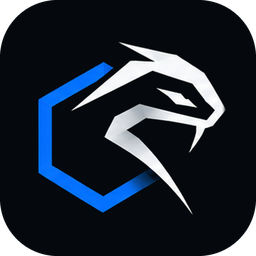

<p align="center">
  
</p>

<h1 align="center">Soliton Rudder</h1>

<p align="center">
  A fast, modern desktop app for managing Kubernetes clusters.<br>
  Live tables · pod shells · logs · port-forwarding · ingress map · cluster assessments · Argo CD, Flux, Helm &amp; Prometheus · plugins
</p>

<p align="center">
  <a href="https://github.com/solitonhq/soliton-rudder/actions/workflows/ci.yml"></a>
  <a href="LICENSE"></a>
  <a href="https://github.com/solitonhq/soliton-rudder/releases"></a>
  <a href="https://scorecard.dev/viewer/?uri=github.com/solitonhq/soliton-rudder"></a>
  
</p>

---

Soliton Rudder is a native-feeling Kubernetes IDE built with [Wails](https://wails.io) (Go) and React. It uses the
system WebView instead of bundling a browser, so it starts quickly and stays light, and it streams cluster data
with watches so everything you see is live.

> **Status:** early (0.x). macOS only for now. Expect rough edges and fast iteration. Feedback is very welcome.

## Highlights

- **Live, fast tables** for every resource kind including CRDs: virtualized, sortable, searchable, multi-namespace.
- **Plain-language health** for pods, workloads and nodes: *why* something is failing and what to try.
- **Pod shells and a cluster terminal** with `kubectl` already pointed at the right cluster; **multi-pod log viewer**
  with levels, JSON formatting, search and download.
- **Self-healing port forwarding**: one click on any Pod, Service or workload; the local port stays open and rebinds to a healthy replica when pods restart or roll, with live repair metrics.
- **Manifest apply** with a server-side dry-run and a before/after diff.
- **Applications**: find applications by Helm release or labels, see their health, version, URLs and Helm history (diff any two revisions, roll back with a preview).
- **Works with limited permissions**: if your credentials only cover some namespaces, every page adapts namespace by namespace instead of failing.
- **Cluster overview**: the first page of a cluster: health of nodes, pods and workloads, capacity (requests vs usage), what needs attention (with runbooks) and recent warnings.
- **Topology map**: live Ingress → Service → Workload → Pod → Node graph with health colours, upstream/downstream highlighting and a "problems only" mode.
- **Simulator**: "can A reach B?" against your NetworkPolicies, and "what happens if I drain this node?" (PDBs, spare capacity, autoscalers), both read-only.
- **Compare clusters**: field-level drift between two clusters/namespaces and *selective promote* (dry-run on the target, nothing is written without confirmation; Secrets are never read).
- **Blackbox & runbooks**: opt-in recorder of health changes and events with a time-travel slider (what was failing at 03:12?), and step-by-step runbooks with read-only checks you can run in place.
- **Ingress map**: host → path → Service → pods, with TLS expiry, broken backends and route conflicts called out.
- **ConfigMap / Secret viewer** that understands JSON, YAML, env files and certificates; Secrets stay masked until revealed.
- **Certificate inventory**: every TLS secret with expiry, SANs, issuer (Let's Encrypt / cert-manager) and who uses it; expiring certificates also feed the assessment.
- **Debug containers**: one click injects a `netshoot`-style ephemeral container into any running pod (even distroless) and opens a shell in it.
- **Cluster assessments**: 36 read-only checks across resources, reliability, security and maintenance, a 0–100
  score, fix guidance, **history, trend charts and run-to-run comparison**, exportable to HTML/JSON.
- **GitOps & monitoring built in**: Argo CD, Flux, Helm releases, and Prometheus (history charts + PromQL).
- **Plugins**: add panels, ⌘K commands and assessment rules; sandboxed UI, permission-checked API.
- **Three themes** (Dark Black, Dark Blue, Light), a ⌘K command palette and full keyboard/accessibility support.
- **Private by design**: no telemetry, no account; credentials stay in your kubeconfig or the macOS Keychain.

## Install

Download the DMG from the [latest release](https://github.com/solitonhq/soliton-rudder/releases), drag
**Soliton Rudder** to **Applications**, and open it. Full instructions (including Gatekeeper, Keychain prompts, cloud
auth, updating and uninstalling) are in **[docs/INSTALL.md](docs/INSTALL.md)**.

```bash
# or build from source (macOS, Go, Node 20.19+, Wails v2.17)
git clone https://github.com/solitonhq/soliton-rudder.git && cd soliton-rudder
make build && open "build/bin/Soliton Rudder.app"
```

Requires **macOS 12+**, Apple Silicon or Intel. A kubeconfig is all you need.

## Documentation

| | |
|---|---|
| [Installation](docs/INSTALL.md) | DMG, first launch, prompts, uninstall, build from source |
| [Getting started](docs/GETTING-STARTED.md) | A ten-minute tour |
| [User guide](docs/USER-GUIDE.md) | Every feature, shortcuts, required permissions |
| [Integrations](docs/INTEGRATIONS.md) | Argo CD, Flux, Helm, Prometheus |
| [Assessment rules](docs/ASSESSMENT-RULES.md) | The 36 built-in checks |
| [Security & privacy](docs/SECURITY-AND-PRIVACY.md) | What's stored, network activity, sandboxing |
| [Troubleshooting & FAQ](docs/TROUBLESHOOTING.md) | Common problems |
| [Plugin guide](docs/PLUGINS.md) | Write your own plugin |
| [Architecture](docs/ARCHITECTURE.md) · [Development](docs/DEVELOPMENT.md) · [Releasing](docs/RELEASING.md) | For contributors and maintainers |

## Contributing

Bug reports, ideas and pull requests are welcome. Read [CONTRIBUTING.md](CONTRIBUTING.md) and the
[Code of Conduct](CODE_OF_CONDUCT.md). See the [roadmap](ROADMAP.md) for where the project is heading,
[GOVERNANCE.md](GOVERNANCE.md) for how it is run and [SUPPORT.md](SUPPORT.md) for where to ask questions. For security
issues see [SECURITY.md](SECURITY.md).

## License

[Apache License 2.0](LICENSE). Third-party components and their licenses are listed in
[THIRD_PARTY_NOTICES.txt](THIRD_PARTY_NOTICES.txt) (also shown in *Settings → About*).

"Kubernetes", "Helm", "Argo", "Flux" and "Prometheus" are trademarks of their respective owners. Soliton Rudder is an
independent project and is not affiliated with, endorsed by, or sponsored by The Linux Foundation, the CNCF or those
projects.
